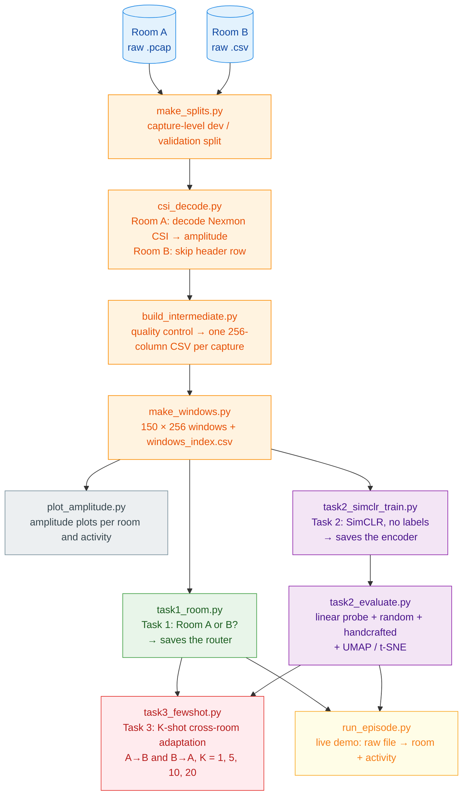

<div align="center">

# 📡 wi-adapt 🏠➡️🏠

### WiFi sees you move: cross-room, few-label activity recognition from CSI

🛜 Raw Nexmon CSI → 🧹 our own Python pipeline → 🧠 self-supervised encoder → 🎯 K-shot adaptation to a new room


*🎓 CS60055 Ubiquitous Computing · Hackathon Challenge 2: "Cross-Room Few-Shot Adaptation"*

[📖 About](#-about-the-project) · [🔄 Pipeline](#-pipeline) · [📁 Folders](#-folder-structure) · [🧩 Files](#-what-each-file-does) · [⚙️ Setup](#️-setup) · [🚀 Run](#-how-to-run-from-the-start) · [🛡️ Rules](#️-rules-we-follow-leakage-control) · [👥 Contact](#-contribution-and-contact)

</div>

---

## 📖 About the project

WiFi signals change when people move. The **Channel State Information (CSI)** of every WiFi packet tells us how strongly each of the 256 frequency channels (subcarriers) arrived, so a stream of packets becomes a "movie" of 256 numbers per moment. From it we can recognise activities like sitting, walking or falling, with no camera.

> [!IMPORTANT]
> **The problem:** the **room** changes the signal too. A model trained in one room often fails in another.
> This project asks: *if we install the system in a new room and can label only a few examples, how well can it still recognise activities?*

We use the **CSI Human Activity dataset** (Schäfer et al., 2021) with two rooms:

| | 🅰️ Room A (Experiment 2) | 🅱️ Room B (Experiment 3) |
|---|---|---|
| 📦 **Raw format** | `.pcap` (raw Nexmon packets, BCM4366c0, 80 MHz) | `.csv` (amplitude, 256 columns) |
| 🏃 **Activities** | SIT, STAND, WALK, SITDOWN, STANDUP, FALL | EMPTY, LYING, SIT, STAND, WALK |
| 🗂️ **Captures** | 934 development + 150 validation | 1,076 development + 125 validation |

The project has three tasks:

| | Task | Question | Our approach |
|---|---|---|---|
| 🟢 | **1. Room identification** | Which room is this 150 × 256 window from? | Logistic regression on per-subcarrier statistics. Also used as the **router** in Task 3. |
| 🟣 | **2. Learn without labels** | Can a network learn useful CSI features with no labels? | **SimCLR** on a 1D ResNet-style CNN, then a frozen **linear probe**, compared with random weights and handcrafted features |
| 🔴 | **3. Cross-room few-label adaptation** | Can we recognise activities in a room using only K labelled captures from it? | Frozen SimCLR encoder + per-room normalization + **prototypes** (nearest class average) + predicted-room routing |

> [!NOTE]
> Everything, from reading the raw packets to the final predictions, is **our own Python code**. The source authors' MATLAB code is not used.

---

## 🔄 Pipeline



<div align="center">

🔵 raw data &nbsp;·&nbsp; 🟠 data pipeline &nbsp;·&nbsp; 🟢 Task 1 &nbsp;·&nbsp; 🟣 Task 2 &nbsp;·&nbsp; 🔴 Task 3 &nbsp;·&nbsp; 🟡 live demo

</div>

---

## 📁 Folder structure

| ✅ Pushed to GitHub | ❌ Not pushed |
|---|---|
| `src/`, `configs/`, `requirements.txt`, `.gitignore`, `README.md`, `episodes/test1/README.md`, `splits/`, `reports/`, `results/`, and the technical report | `data/` and `models/`. They are created when you run the pipeline (the dataset must not be committed). |

<details open>
<summary><b>🌳 Click to show / hide the full tree</b></summary>

```
wi-adapt/
├── README.md
├── requirements.txt
├── .gitignore
│
├── configs/
│   └── experiment.yaml            all pipeline settings in one place
│
├── src/                           all code (see "What each file does")
│   ├── csi_decode.py   common.py   models.py   fewshot.py
│   ├── make_splits.py  build_intermediate.py   make_windows.py
│   ├── plot_amplitude.py
│   ├── task1_room.py
│   ├── task2_simclr_train.py   task2_evaluate.py
│   ├── task3_fewshot.py
│   ├── run_episode.py
│   └── tools/                     optional one-time checks
│
├── episodes/
│   └── test1/
│       └── README.md              put the .pcap / .csv files to predict here
│
├── data/                          NOT pushed: you add raw/, the rest is created
│   ├── raw/                       ← you put the dataset here (read-only)
│   │   ├── Experiment-2/          Room A
│   │   │   ├── ReadMe.pdf
│   │   │   └── realdata/input_data/30ms/csidata/
│   │   │       ├── fall/  sit/  sitdown/  stand/  standup/  walk/   *.pcap (development)
│   │   │       └── validation/
│   │   │           └── fall/  sit/  sitdown/  stand/  standup/  walk/   25 *.pcap each
│   │   └── Experiment-3/          Room B
│   │       ├── ReadMe.pdf
│   │       └── Data/
│   │           ├── Empty_Amp_*.csv   Lying_Amp_*.csv
│   │           ├── Sitting_Amp_*.csv Standing_Amp_*.csv
│   │           └── Walking_*.csv
│   ├── intermediate_csv/          created: one 256-column CSV per capture
│   │   ├── room_A/  room_B/
│   ├── windows/                   created: 150 × 256 float32 .npy windows
│   │   ├── development/  validation/
│   └── cache/                     created: development captures in one file (Task 2)
│
├── models/                        NOT pushed, created by running
│   ├── task1_router.joblib
│   ├── task2_simclr_encoder.pt    task2_simclr_embeddings.npz
│   └── episode_model_fewshot_K5_seed0.joblib   (both models: B→A and A→B)
│
├── splits/                        created, pushed (provenance)
│   ├── captures.csv               every capture: room, label, development / validation
│   ├── split_info.json            the split rule (seed 42, 25 per class)
│   ├── windows_index.csv          every window → its capture, start row, version
│   └── support/task3_support.csv  the K-shot support captures used in Task 3
│
├── reports/                       created, pushed (quality control record)
│   ├── qc_log.csv  qc_summary.txt
│   └── (inspection reports from src/tools/)
│
└── results/                       created, pushed
    ├── experiments.csv            experiment, target_room, K, metric, value
    ├── tables/                    all result tables
    ├── predictions/               window_id, room, label, confidence
    └── figures/
        ├── amplitude/  task1/  task2/  task3/
```

</details>

---

## 🧩 What each file does

### ▶️ Files you run

| # | File | What it does | Creates |
|:-:|---|---|---|
| 1️⃣ | `src/make_splits.py` | Lists every capture of both rooms and fixes the **development / validation split** at capture level. Room A: the supplied `validation/` folder. Room B: 25 per class, sorted filenames, seed 42. | `splits/captures.csv`, `splits/split_info.json` |
| 2️⃣ | `src/build_intermediate.py` | Brings both rooms into **one common format**: decodes Room A, reads Room B, applies quality control and writes one 256-column CSV per capture | `data/intermediate_csv/`, `reports/qc_log.csv`, `reports/qc_summary.txt` |
| 3️⃣ | `src/make_windows.py` | Cuts the official **150 × 256 windows**: 1 from the middle of each validation capture, up to 3 per development capture | `data/windows/`, `splits/windows_index.csv` |
| 4️⃣ | `src/plot_amplitude.py` | **Amplitude plots** for every activity in every room | `results/figures/amplitude/` |
| 5️⃣ | `src/task1_room.py` | 🟢 **Task 1:** room classifier, accuracy vs window length, confusion matrix. Saves the **router**. | `results/tables/task1_*`, `results/figures/task1/`, `models/task1_router.joblib` |
| 6️⃣ | `src/task2_simclr_train.py` | 🟣 **Task 2, part 1:** trains the encoder with **SimCLR** on development captures, **no labels** | `models/task2_simclr_encoder.pt`, training curve |
| 7️⃣ | `src/task2_evaluate.py` | 🟣 **Task 2, part 2:** frozen encoder → **linear probe** (+ k-NN extra), compared with random weights and handcrafted features, plus UMAP / t-SNE plots | `results/tables/task2_*`, `results/figures/task2/`, `models/task2_simclr_embeddings.npz` |
| 8️⃣ | `src/task3_fewshot.py` | 🔴 **Task 3:** K-shot cross-room adaptation, both directions, K = 1/5/10/20, 5 seeds, routing comparison, SSL comparison, confusion matrices | `results/tables/task3_*`, `results/figures/task3/`, `splits/support/` |
| 9️⃣ | `src/run_episode.py` | 🟡 **Live demo:** raw `.pcap` / `.csv` file(s) → room + activity predictions | `episodes/<name>/predictions.csv` |

### 🧰 Helper files (not run directly)

| File | What it does |
|---|---|
| 📶 `src/csi_decode.py` | Reads raw files. Room A: pcap → UDP port 5500 → 18-byte Nexmon header → 1,024 CSI bytes → 256 complex values (sign-mantissa-exponent format) → amplitude. Room B: CSV without its header row. |
| 🔧 `src/common.py` | Shared tools: load the config, per-window normalization, load windows, write results |
| 🧠 `src/models.py` | The 1D ResNet-style CNN encoder and the SimCLR projection head |
| 🎯 `src/fewshot.py` | The Task 3 method: per-room normalization, prototypes, classification, self-training |
| ⚙️ `configs/experiment.yaml` | Every setting (seed, QC rules, window size, model and training settings, K values) |

---

## ⚙️ Setup

**1️⃣ Python:** 3.10 – 3.12 recommended. Newer versions work if PyTorch supports them.

**2️⃣ Get the code and make a virtual environment:**

```bash
git clone https://github.com/Nishantdas77/wi-adapt.git
cd wi-adapt
python -m venv .venv
# Windows:
.venv\Scripts\activate
# Linux / macOS:
source .venv/bin/activate
pip install -r requirements.txt
```

**3️⃣ Get the data** (not included in this repository):

- 📥 Download the data package shared by the teaching team (CSI Human Activity dataset, [IEEE DataPort](https://ieee-dataport.org/open-access/csi-human-activity)).
- 📂 Unzip it and place the folders so that you have `data/raw/Experiment-2/` and `data/raw/Experiment-3/` (layout shown above).
- 🧹 Delete archive leftovers: every `__MACOSX` folder and `.DS_Store` file.

> [!WARNING]
> Delete or move outside the project the source authors' `matlab code` and `Results` folders. They are not used and not allowed.

---

## 🚀 How to run (from the start)

> [!TIP]
> Run every command from the **main project folder** (`wi-adapt/`), not from inside `src/`.

| Step | Command | ⏱️ Time (CPU, approx.) |
|---|---|---|
| 1️⃣ Split | `python src/make_splits.py` | seconds |
| 2️⃣ Common format + QC | `python src/build_intermediate.py` | a few minutes |
| 3️⃣ Windows | `python src/make_windows.py` | a few minutes |
| 4️⃣ Amplitude plots | `python src/plot_amplitude.py` | ~1 minute |
| 5️⃣ 🟢 Task 1 | `python src/task1_room.py` | ~1–2 minutes |
| 6️⃣ 🟣 Task 2: quick check | `python src/task2_simclr_train.py --quick` | ~1–2 minutes (+ a one-time cache build) |
| 7️⃣ 🟣 Task 2: train | `python src/task2_simclr_train.py` | ~30–50 minutes |
| 8️⃣ 🟣 Task 2: evaluate | `python src/task2_evaluate.py` | a few minutes |
| 9️⃣ 🔴 Task 3 | `python src/task3_fewshot.py` | a few minutes |

Each step uses only what the steps before it created. If you change a setting in `configs/experiment.yaml`, rerun from the step that uses it.

### 🟡 Live demo: predict new files

**1.** Put the `.pcap` (Room A style) or `.csv` (Room B style) file(s) in `episodes/test1/`.

**2.** Run:

```bash
python src/run_episode.py episodes/test1
```

**3.** Read `episodes/test1/predictions.csv`:

| Column | Meaning |
|---|---|
| 🆔 `window_id` | `<file name>_w<number>` |
| 🏠 `room` | Predicted room (A or B), from the signal only |
| 🏃 `label` | Predicted activity |
| 📈 `confidence` | How sure the model is (0–1) |
| ℹ️ `source_file`, `start_row`, `n_rows`, `room_confidence`, `note` | Extra information (`note = short_window` if the file had fewer than 150 valid rows) |

> [!NOTE]
> **How it decides:** the Task 1 router predicts the room. Room A uses the **B → A** model, Room B uses the **A → B** model (Task 3 setup, K = 5).
> **Options:** `--K <n>` (support captures per target-only activity: 1, 5, 10 or 20, default 5), `--all-windows` (one prediction per 150-row window), `--out <file>`, `--rebuild` (after retraining Task 2).
> File names are never used for prediction; the file type only selects the reader.

---

## 🛡️ Rules we follow (leakage control)

| | Rule |
|:-:|---|
| ✂️ | **Capture-level split:** all windows of a capture stay in the same split. Room A uses the supplied validation folder; Room B uses 25 captures per class, sorted filenames, seed 42. |
| 🔒 | **Validation is used only for scoring:** never for training, normalization, model fitting or Task 3 support. |
| 🚫 | **No metadata as features:** file names, folders, extensions, capture length and packet count are never model inputs. |
| 🙈 | **Task 2 has no labels in SSL:** the encoder never sees activity or room labels. |
| 🎯 | **Task 3:** support captures come only from the **target room's development** captures. K = distinct captures. Target labels of SIT, STAND and WALK are never used. |

---

## 👥 Contribution and contact

| 👤 Member | 🎓 Roll number | 📧 Contact |
|---|---|---|
| Nishant Kumar Das | 25CS72P06 | [dasnishant7777](mailto:dasnishant7777@gmail.com) |

🤖 **AI use:** AI tools were used during development, as disclosed in the technical report (AI-use disclosure section).

📄 **Technical report:** [`report/technical_report.pdf`](report/technical_report.pdf)

---

## 📚 References

1. 📊 CSI Human Activity dataset, IEEE DataPort: https://ieee-dataport.org/open-access/csi-human-activity
2. 📝 J. Schäfer, B. R. Barrsiwal, M. Kokhkharova, H. Adil, J. Liebehenschel. "Human Activity Recognition Using CSI Information with Nexmon." *Applied Sciences*, 2021, 11(19), 8860. https://doi.org/10.3390/app11198860
3. 📶 Nexmon CSI (public documentation of the CSI extraction and format): https://github.com/seemoo-lab/nexmon_csi
4. 🧠 T. Chen, S. Kornblith, M. Norouzi, G. Hinton. "A Simple Framework for Contrastive Learning of Visual Representations" (SimCLR). ICML 2020.
5. 🎯 J. Snell, K. Swersky, R. Zemel. "Prototypical Networks for Few-shot Learning." NeurIPS 2017.

---

<div align="center">

*🏛️ Built for CS60055 Ubiquitous Computing course (Term Project) — IIT Kharagpur*

</div>